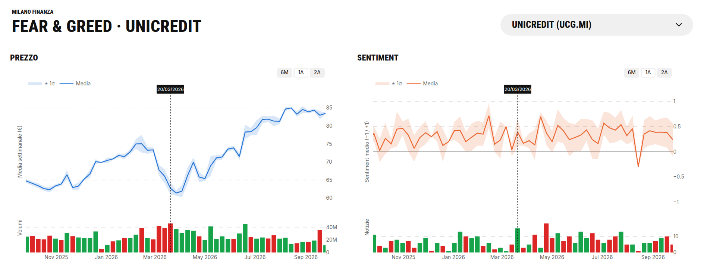
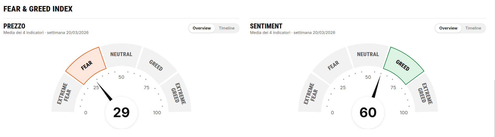
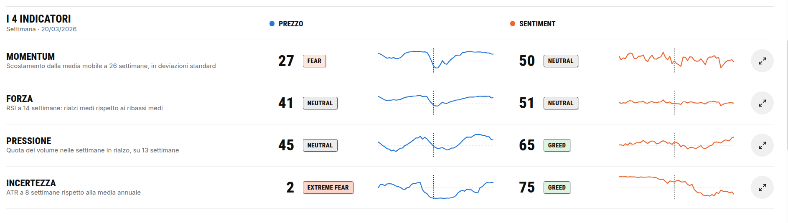
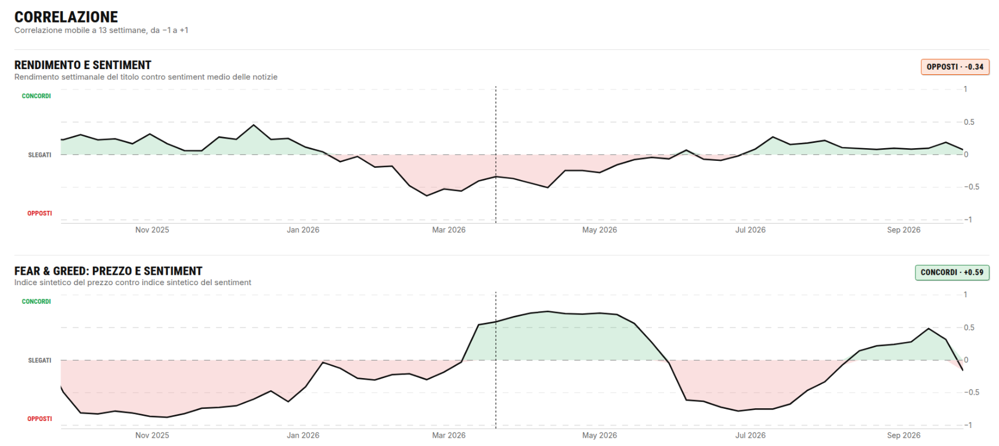

# Milano Finanza · Sentiment & Market Intelligence Dashboard

## Il progetto

Per l’hackathon **Milano Finanza**, abbiamo sviluppato una dashboard che mette a
confronto l’andamento di un titolo azionario con il sentiment espresso dalle
notizie pubblicate sullo stesso titolo.

L’obiettivo non è mostrare due serie temporali separate, ma rendere leggibile la
relazione tra mercato e informazione: la dashboard evidenzia quando prezzo e
sentiment si muovono nella stessa direzione, quando divergono e quando il
segnale informativo può essere in ritardo rispetto al movimento del titolo.

Il prototipo è attualmente configurato su **UniCredit (UCG.MI)** e usa dati
settimanali per costruire una vista storica coerente tra quotazioni, volumi,
notizie e indicatori.

## Cosa mostra la dashboard

### Prezzo e sentiment sincronizzati

La vista principale presenta due grafici affiancati con la stessa scala
temporale:

- **Prezzo**: media settimanale, banda di variabilità pari a ±1 deviazione
  standard e volumi con colore coerente con la direzione del movimento;
- **Sentiment**: media settimanale del sentiment delle notizie, banda ±1
  deviazione standard e numero di notizie pubblicate;
- **selezione condivisa**: cliccando una settimana si aggiorna il punto
  corrispondente su entrambi i grafici e vengono mostrati prezzo, sentiment,
  variabilità, volume e numero di notizie.

### Indicatori gemelli

Per rendere confrontabili le due serie, calcoliamo gli stessi indicatori sia
per il prezzo sia per il sentiment:

| Indicatore | Interpretazione |
| --- | --- |
| **Momentum** | Scostamento dalla media mobile a 26 settimane, espresso in deviazioni standard |
| **Forza** | RSI a 14 settimane, adattato alla serie osservata |
| **Pressione** | Quota del volume associata alle settimane in rialzo, su una finestra di 13 settimane |
| **Incertezza** | ATR a 8 settimane confrontato con la media annuale |

Ogni indicatore viene riportato su una scala comune **Fear & Greed (0–100)**.
Questo permette di confrontare, ad esempio, un momentum elevato del prezzo con
un sentiment ancora neutro o negativo.

### Correlazione e divergenze

La dashboard calcola inoltre correlazioni mobili a 13 settimane tra:

- rendimento del titolo e sentiment medio delle notizie;
- indice sintetico Fear & Greed del prezzo e indice Fear & Greed del sentiment.

Le aree in cui le serie risultano **opposte** o poco correlate sono i punti più
interessanti da investigare. Una divergenza può rappresentare, per esempio:

- un possibile segnale anticipatore del sentiment rispetto al prezzo;
- una reazione del mercato non ancora riflessa nella rassegna stampa;
- un ritardo nella pubblicazione o nella percezione delle notizie;
- una fase di incertezza in cui prezzo e informazione non confermano la stessa
  direzione.

Questi eventi sono quindi **segnali informativi per l’analisi**, non
raccomandazioni automatiche di acquisto o vendita.

## Dati e pipeline analitica

Il progetto combina due fonti principali:

1. **Quotazioni del titolo**: valori OHLC, prezzo medio, volumi e variazione nel
   tempo;
2. **Rassegna stampa**: articoli associati al titolo, aggregati per settimana e
   trasformati in uno score di sentiment.

La pipeline aggrega le osservazioni sulla stessa frequenza temporale, calcola
gli indicatori tecnici per entrambe le serie, normalizza i risultati sulla scala
Fear & Greed e li porta nella dashboard con una timeline condivisa.

## Risultato

Il risultato è un prototipo di **market intelligence** che unisce analisi
quantitativa e lettura dell’informazione finanziaria in un’unica interfaccia.
Invece di limitarsi a classificare una notizia come positiva o negativa, il
progetto prova a rispondere a una domanda più utile per l’analista:

> *Il mercato e il sentiment stanno raccontando la stessa storia? Se non lo
> fanno, quando e quanto è significativa la divergenza?*

## Struttura del progetto

- [`frontend/`](frontend/) — dashboard React/Vite e componenti dei grafici;
- [`indicatori/`](indicatori/) — calcolo e verifica degli indicatori;
- [`scripts/`](scripts/) — preparazione ed esportazione dei dati per il frontend;
- [`notebooks/`](notebooks/) — analisi esplorative e accesso ai dati;
- [`data/`](data/) — dati locali utilizzati dal progetto.

> **Nota:** il progetto ha finalità dimostrative e di ricerca per l’hackathon.
> Gli indicatori e le divergenze visualizzati non costituiscono consulenza
> finanziaria né una garanzia sull’andamento futuro del titolo.
